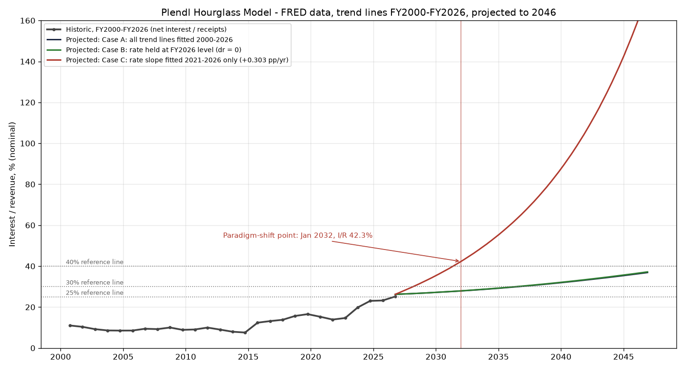
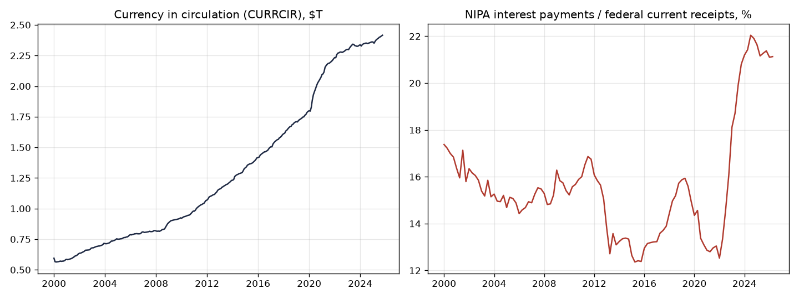

# Plendl Hourglass Model - FRED edition, run 03 November 2026

Model version 1.0.0. Data: FRED (Federal Reserve Bank of St. Louis), downloaded 2026-11-03. Trend lines fitted over FY2000-FY2026. Projection starts 01 October 2026, monthly, 40 years.

Not a Treasury, Federal Reserve, or CBO product. Not financial, investment, budget, or policy advice.

## Headline

- Starting debt D0: $40.525 T (Treasury Debt to the Penny, 2026-10-30); FY2026 year-end debt $40.172 T
- FY2026 receipts: $5.403 T; net interest: $1.360 T; primary deficit: $+0.633 T
- FY2026 interest-to-revenue (I/R): 25.2%; effective rate r0: 3.496%
- Currency in circulation: $2.416 T (2025-10-01), +2.6% year on year
- Observed NIPA interest / receipts (2026-04-01): 21.1% ($1.280 T / $6.056 T SAAR)

## Calculated paradigm-shift point

| Case | Paradigm-shift point | First month I/R >= 30% | First month I/R >= 40% |
| --- | --- | --- | --- |
| Case A: all trend lines fitted 2000-2026 | None through September 2066 | Sep 2036 | Sep 2050 |
| Case B: rate held at FY2026 level (dr = 0) | None through September 2066 | Jul 2036 | Mar 2050 |
| Case C: rate slope fitted 2021-2026 only (+0.303 pp/yr) | January 2032 (I/R 42.3%) | Apr 2028 | Jun 2031 |

Test: g_q(t) = 12 ln(q_t+1/q_t) and a(t) = g_q(t) - g_q(t-1). The paradigm-shift point is the first month from which, for every remaining month of the horizon, both g_q > 0 and a > 0. 30%/40% are reference lines only.

## Fitted trend lines (OLS)

| Series | Fit | Parameter | R^2 |
| --- | --- | --- | --- |
| Receipts | log-linear | g_R = 4.20% / yr | 0.917 |
| Gross debt (reference) | log-linear | 8.07% / yr | 0.991 |
| Effective rate (net interest / avg debt) | linear | dr = -0.0011 pp / yr | 0.000 |
| Primary deficit / receipts | linear | b_s = +0.939 pp / yr (start s0 = 11.7%) | 0.106 |

## Calculated values, yearly points (Case A; I/R for all cases)

| Point | Debt $T | Interest $T | Revenue $T | Primary deficit $T | Rate % | I/R A % | I/R B % | I/R C % |
| --- | --- | --- | --- | --- | --- | --- | --- | --- |
| Oct 2026 | 40.52 | 1.42 | 5.40 | +0.63 | 3.50 | 26.2 | 26.2 | 26.2 |
| Oct 2027 | 42.64 | 1.49 | 5.63 | +0.71 | 3.49 | 26.5 | 26.5 | 28.8 |
| Oct 2028 | 44.92 | 1.57 | 5.87 | +0.80 | 3.49 | 26.7 | 26.8 | 31.6 |
| Oct 2029 | 47.37 | 1.65 | 6.11 | +0.89 | 3.49 | 27.1 | 27.1 | 34.6 |
| Oct 2030 | 49.99 | 1.75 | 6.37 | +0.99 | 3.49 | 27.4 | 27.4 | 37.8 |
| Oct 2031 | 52.81 | 1.84 | 6.64 | +1.09 | 3.49 | 27.8 | 27.8 | 41.3 |
| Oct 2032 | 55.84 | 1.95 | 6.92 | +1.20 | 3.49 | 28.2 | 28.2 | 45.2 |
| Oct 2033 | 59.10 | 2.06 | 7.21 | +1.32 | 3.49 | 28.6 | 28.7 | 49.4 |
| Oct 2034 | 62.59 | 2.18 | 7.51 | +1.44 | 3.49 | 29.0 | 29.1 | 54.0 |
| Oct 2035 | 66.33 | 2.31 | 7.83 | +1.58 | 3.49 | 29.5 | 29.6 | 59.1 |
| Oct 2036 | 70.35 | 2.45 | 8.16 | +1.72 | 3.48 | 30.0 | 30.2 | 64.7 |
| Oct 2037 | 74.66 | 2.60 | 8.50 | +1.87 | 3.48 | 30.6 | 30.7 | 70.9 |
| Oct 2038 | 79.28 | 2.76 | 8.86 | +2.03 | 3.48 | 31.2 | 31.3 | 77.8 |
| Oct 2039 | 84.23 | 2.93 | 9.23 | +2.21 | 3.48 | 31.8 | 31.9 | 85.5 |
| Oct 2040 | 89.53 | 3.12 | 9.62 | +2.39 | 3.48 | 32.4 | 32.6 | 94.0 |
| Oct 2041 | 95.22 | 3.31 | 10.02 | +2.58 | 3.48 | 33.0 | 33.2 | 103.4 |
| Oct 2042 | 101.30 | 3.52 | 10.44 | +2.79 | 3.48 | 33.7 | 33.9 | 114.0 |
| Oct 2043 | 107.82 | 3.75 | 10.88 | +3.01 | 3.48 | 34.4 | 34.7 | 125.7 |
| Oct 2044 | 114.79 | 3.99 | 11.34 | +3.24 | 3.48 | 35.2 | 35.4 | 138.9 |
| Oct 2045 | 122.26 | 4.25 | 11.82 | +3.49 | 3.47 | 35.9 | 36.2 | 153.6 |
| Oct 2046 | 130.24 | 4.52 | 12.31 | +3.75 | 3.47 | 36.7 | 37.0 | 170.0 |

## Historic data (FRED)

| FY | Receipts $T | Outlays $T | Net interest $T | Primary deficit $T | Gross debt $T | Eff. rate % | I/R % |
| --- | --- | --- | --- | --- | --- | --- | --- |
| 2000 | 2.025 | 1.789 | 0.223 | -0.459 | 5.67 | 3.935 | 11.0 |
| 2001 | 1.991 | 1.863 | 0.206 | -0.334 | 5.81 | 3.591 | 10.4 |
| 2002 | 1.853 | 2.011 | 0.171 | -0.013 | 6.23 | 2.841 | 9.2 |
| 2003 | 1.782 | 2.160 | 0.153 | +0.225 | 6.78 | 2.353 | 8.6 |
| 2004 | 1.880 | 2.293 | 0.160 | +0.252 | 7.38 | 2.263 | 8.5 |
| 2005 | 2.154 | 2.472 | 0.184 | +0.134 | 7.93 | 2.403 | 8.5 |
| 2006 | 2.407 | 2.655 | 0.227 | +0.022 | 8.51 | 2.757 | 9.4 |
| 2007 | 2.568 | 2.729 | 0.237 | -0.076 | 9.01 | 2.708 | 9.2 |
| 2008 | 2.524 | 2.983 | 0.253 | +0.206 | 10.02 | 2.656 | 10.0 |
| 2009 | 2.105 | 3.518 | 0.187 | +1.226 | 11.91 | 1.704 | 8.9 |
| 2010 | 2.163 | 3.457 | 0.196 | +1.098 | 13.56 | 1.541 | 9.1 |
| 2011 | 2.303 | 3.603 | 0.230 | +1.070 | 14.79 | 1.622 | 10.0 |
| 2012 | 2.450 | 3.527 | 0.220 | +0.856 | 16.07 | 1.429 | 9.0 |
| 2013 | 2.775 | 3.455 | 0.221 | +0.459 | 16.74 | 1.347 | 8.0 |
| 2014 | 3.021 | 3.506 | 0.229 | +0.256 | 17.82 | 1.325 | 7.6 |
| 2015 | 3.249 | 3.688 | 0.402 | +0.037 | 18.15 | 2.236 | 12.4 |
| 2016 | 3.267 | 3.854 | 0.430 | +0.157 | 19.57 | 2.280 | 13.2 |
| 2017 | 3.315 | 3.981 | 0.457 | +0.209 | 20.24 | 2.295 | 13.8 |
| 2018 | 3.329 | 4.108 | 0.522 | +0.257 | 21.52 | 2.498 | 15.7 |
| 2019 | 3.462 | 4.447 | 0.573 | +0.411 | 22.72 | 2.590 | 16.5 |
| 2020 | 3.420 | 6.552 | 0.523 | +2.609 | 26.95 | 2.105 | 15.3 |
| 2021 | 4.046 | 6.818 | 0.562 | +2.210 | 28.43 | 2.031 | 13.9 |
| 2022 | 4.896 | 6.272 | 0.718 | +0.658 | 30.93 | 2.418 | 14.7 |
| 2023 | 4.439 | 6.134 | 0.879 | +0.816 | 33.17 | 2.744 | 19.8 |
| 2024 | 4.919 | 6.752 | 1.133 | +0.700 | 35.46 | 3.302 | 23.0 |
| 2025 | 5.235 | 7.010 | 1.216 | +0.560 | 37.64 | 3.326 | 23.2 |
| 2026 | 5.403 | 7.396 | 1.360 | +0.633 | 40.17 | 3.496 | 25.2 |

Note: Debt (all years) = Treasury Debt to the Penny at fiscal-year end; FY2026: $40.172 T (2026-09-30). Starting debt D0 = latest Debt to the Penny, $40.525 T (2026-10-30). For reference, FRED GFDEBTN latest = $39.462 T (2026-04-01, quarter start date) and FYGFD FY2025 = $37.375 T (OMB concept).

## Data series

- `FYFR`: Federal Receipts, fiscal year (millions $, annual FY) - https://fred.stlouisfed.org/series/FYFR
- `FYONET`: Federal Net Outlays, fiscal year (millions $, annual FY) - https://fred.stlouisfed.org/series/FYONET
- `FYOINT`: Federal Outlays: Interest, fiscal year (millions $, annual FY) - https://fred.stlouisfed.org/series/FYOINT
- `FYGFD`: Gross Federal Debt, fiscal year end (reference only) (billions $, annual FY) - https://fred.stlouisfed.org/series/FYGFD
- `GFDEBTN`: Federal Debt: Total Public Debt (reference only) (millions $, quarterly) - https://fred.stlouisfed.org/series/GFDEBTN
- `MTSR133FMS`: Monthly Treasury Statement: Total Receipts (millions $, monthly) - https://fred.stlouisfed.org/series/MTSR133FMS
- `MTSO133FMS`: Monthly Treasury Statement: Total Outlays (millions $, monthly) - https://fred.stlouisfed.org/series/MTSO133FMS
- `A091RC1Q027SBEA`: Federal government current expenditures: Interest payments (billions $ SAAR, quarterly) - https://fred.stlouisfed.org/series/A091RC1Q027SBEA
- `FGRECPT`: Federal government current receipts (billions $ SAAR, quarterly) - https://fred.stlouisfed.org/series/FGRECPT
- `CURRCIR`: Currency in Circulation (billions $, monthly) - https://fred.stlouisfed.org/series/CURRCIR
- Treasury Debt to the Penny (total public debt outstanding, daily, $) - https://api.fiscaldata.treasury.gov/services/api/fiscal_service/v2/accounting/od/debt_to_penny
