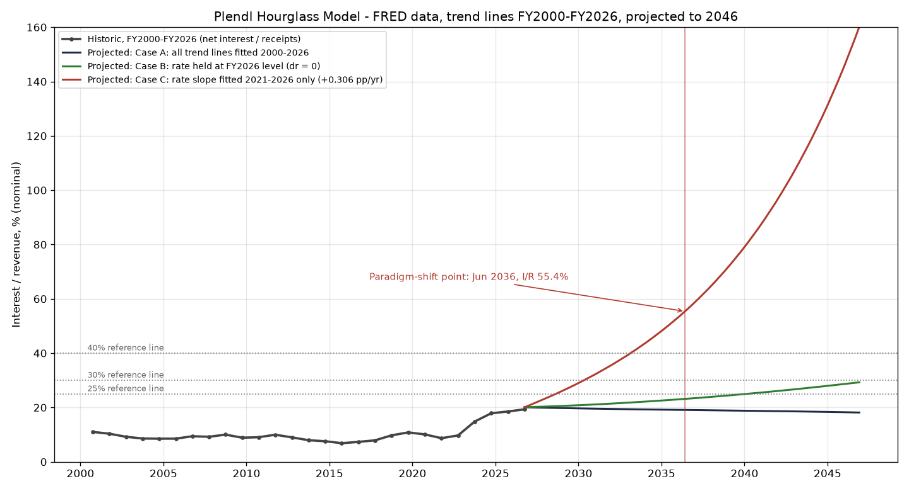
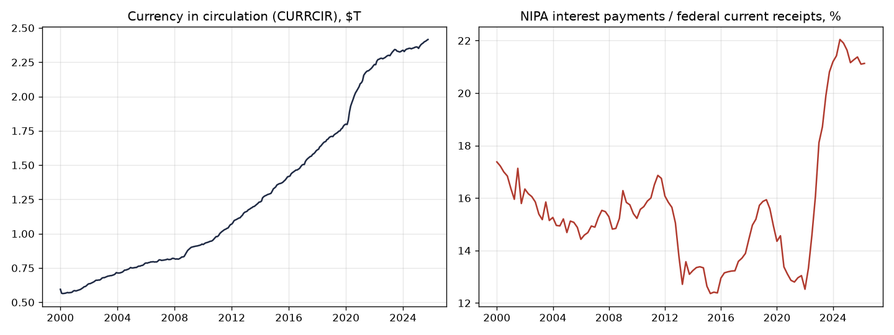

# Plendl Hourglass Model - FRED edition, run 27 October 2026

Model version 1.0.0. Data: FRED (Federal Reserve Bank of St. Louis), downloaded 2026-10-27. Trend lines fitted over FY2000-FY2026. Projection starts 01 October 2026, monthly, 40 years.

Not a Treasury, Federal Reserve, or CBO product. Not financial, investment, budget, or policy advice.

## Headline

- Starting debt D0: $40.463 T (Treasury Debt to the Penny, 2026-10-23); FY2026 year-end debt $40.172 T
- FY2026 receipts: $5.403 T; net interest: $1.044 T (estimated); primary deficit: $+0.948 T
- FY2026 interest-to-revenue (I/R): 19.3%; effective rate r0: 2.684%
- Currency in circulation: $2.416 T (2025-10-01), +2.6% year on year
- Observed NIPA interest / receipts (2026-04-01): 21.1% ($1.280 T / $6.056 T SAAR)

## Calculated paradigm-shift point

| Case | Paradigm-shift point | First month I/R >= 30% | First month I/R >= 40% |
| --- | --- | --- | --- |
| Case A: all trend lines fitted 2000-2026 | None through September 2066 | none | none |
| Case B: rate held at FY2026 level (dr = 0) | None through September 2066 | Jan 2048 | Sep 2059 |
| Case C: rate slope fitted 2021-2026 only (+0.306 pp/yr) | June 2036 (I/R 55.4%) | May 2030 | Mar 2033 |

Test: g_q(t) = 12 ln(q_t+1/q_t) and a(t) = g_q(t) - g_q(t-1). The paradigm-shift point is the first month from which, for every remaining month of the horizon, both g_q > 0 and a > 0. 30%/40% are reference lines only.

## Fitted trend lines (OLS)

| Series | Fit | Parameter | R^2 |
| --- | --- | --- | --- |
| Receipts | log-linear | g_R = 4.21% / yr | 0.917 |
| Gross debt (reference) | log-linear | 8.07% / yr | 0.991 |
| Effective rate (net interest / avg debt) | linear | dr = -0.0445 pp / yr | 0.223 |
| Primary deficit / receipts | linear | b_s = +1.221 pp / yr (start s0 = 17.6%) | 0.174 |

## Calculated values, yearly points (Case A; I/R for all cases)

| Point | Debt $T | Interest $T | Revenue $T | Primary deficit $T | Rate % | I/R A % | I/R B % | I/R C % |
| --- | --- | --- | --- | --- | --- | --- | --- | --- |
| Oct 2026 | 40.46 | 1.09 | 5.40 | +0.95 | 2.68 | 20.1 | 20.1 | 20.1 |
| Oct 2027 | 42.56 | 1.12 | 5.63 | +1.06 | 2.64 | 20.0 | 20.3 | 22.6 |
| Oct 2028 | 44.81 | 1.16 | 5.87 | +1.17 | 2.59 | 19.8 | 20.5 | 25.3 |
| Oct 2029 | 47.23 | 1.20 | 6.11 | +1.30 | 2.55 | 19.7 | 20.8 | 28.2 |
| Oct 2030 | 49.81 | 1.25 | 6.37 | +1.43 | 2.51 | 19.6 | 21.0 | 31.4 |
| Oct 2031 | 52.57 | 1.29 | 6.64 | +1.57 | 2.46 | 19.5 | 21.4 | 34.8 |
| Oct 2032 | 55.52 | 1.34 | 6.92 | +1.72 | 2.42 | 19.4 | 21.7 | 38.5 |
| Oct 2033 | 58.68 | 1.39 | 7.21 | +1.88 | 2.37 | 19.3 | 22.1 | 42.5 |
| Oct 2034 | 62.06 | 1.44 | 7.51 | +2.05 | 2.33 | 19.2 | 22.5 | 47.0 |
| Oct 2035 | 65.66 | 1.50 | 7.83 | +2.23 | 2.28 | 19.2 | 22.9 | 51.9 |
| Oct 2036 | 69.51 | 1.56 | 8.16 | +2.43 | 2.24 | 19.1 | 23.3 | 57.3 |
| Oct 2037 | 73.62 | 1.62 | 8.50 | +2.63 | 2.19 | 19.0 | 23.8 | 63.2 |
| Oct 2038 | 77.99 | 1.68 | 8.86 | +2.85 | 2.15 | 18.9 | 24.3 | 69.8 |
| Oct 2039 | 82.66 | 1.74 | 9.23 | +3.09 | 2.11 | 18.9 | 24.8 | 77.1 |
| Oct 2040 | 87.63 | 1.81 | 9.62 | +3.33 | 2.06 | 18.8 | 25.4 | 85.2 |
| Oct 2041 | 92.92 | 1.87 | 10.02 | +3.60 | 2.02 | 18.7 | 25.9 | 94.3 |
| Oct 2042 | 98.54 | 1.94 | 10.45 | +3.88 | 1.97 | 18.6 | 26.5 | 104.3 |
| Oct 2043 | 104.53 | 2.01 | 10.89 | +4.17 | 1.93 | 18.5 | 27.2 | 115.5 |
| Oct 2044 | 110.89 | 2.09 | 11.34 | +4.49 | 1.88 | 18.4 | 27.8 | 127.9 |
| Oct 2045 | 117.65 | 2.16 | 11.82 | +4.82 | 1.84 | 18.3 | 28.5 | 141.8 |
| Oct 2046 | 124.83 | 2.24 | 12.32 | +5.17 | 1.79 | 18.2 | 29.2 | 157.4 |

## Historic data (FRED)

| FY | Receipts $T | Outlays $T | Net interest $T | Primary deficit $T | Gross debt $T | Eff. rate % | I/R % |
| --- | --- | --- | --- | --- | --- | --- | --- |
| 2000 | 2.025 | 1.789 | 0.223 | -0.459 | 5.67 | 3.935 | 11.0 |
| 2001 | 1.991 | 1.863 | 0.206 | -0.334 | 5.81 | 3.591 | 10.4 |
| 2002 | 1.853 | 2.011 | 0.171 | -0.013 | 6.23 | 2.841 | 9.2 |
| 2003 | 1.782 | 2.160 | 0.153 | +0.225 | 6.78 | 2.353 | 8.6 |
| 2004 | 1.880 | 2.293 | 0.160 | +0.252 | 7.38 | 2.263 | 8.5 |
| 2005 | 2.154 | 2.472 | 0.184 | +0.134 | 7.93 | 2.403 | 8.5 |
| 2006 | 2.407 | 2.655 | 0.227 | +0.022 | 8.51 | 2.757 | 9.4 |
| 2007 | 2.568 | 2.729 | 0.237 | -0.076 | 9.01 | 2.708 | 9.2 |
| 2008 | 2.524 | 2.983 | 0.253 | +0.206 | 10.02 | 2.656 | 10.0 |
| 2009 | 2.105 | 3.518 | 0.187 | +1.226 | 11.91 | 1.704 | 8.9 |
| 2010 | 2.163 | 3.457 | 0.196 | +1.098 | 13.56 | 1.541 | 9.1 |
| 2011 | 2.303 | 3.603 | 0.230 | +1.070 | 14.79 | 1.622 | 10.0 |
| 2012 | 2.450 | 3.527 | 0.220 | +0.856 | 16.07 | 1.429 | 9.0 |
| 2013 | 2.775 | 3.455 | 0.221 | +0.459 | 16.74 | 1.347 | 8.0 |
| 2014 | 3.021 | 3.506 | 0.229 | +0.256 | 17.82 | 1.325 | 7.6 |
| 2015 | 3.250 | 3.692 | 0.223 | +0.219 | 18.15 | 1.241 | 6.9 |
| 2016 | 3.268 | 3.853 | 0.240 | +0.345 | 19.57 | 1.273 | 7.3 |
| 2017 | 3.316 | 3.982 | 0.263 | +0.403 | 20.24 | 1.319 | 7.9 |
| 2018 | 3.330 | 4.109 | 0.325 | +0.454 | 21.52 | 1.556 | 9.8 |
| 2019 | 3.463 | 4.447 | 0.375 | +0.608 | 22.72 | 1.696 | 10.8 |
| 2020 | 3.421 | 6.517 | 0.345 | +2.750 | 26.95 | 1.391 | 10.1 |
| 2021 | 4.047 | 6.821 | 0.352 | +2.421 | 28.43 | 1.273 | 8.7 |
| 2022 | 4.897 | 6.272 | 0.476 | +0.898 | 30.93 | 1.603 | 9.7 |
| 2023 | 4.441 | 6.128 | 0.658 | +1.029 | 33.17 | 2.054 | 14.8 |
| 2024 | 4.920 | 6.735 | 0.880 | +0.935 | 35.46 | 2.564 | 17.9 |
| 2025 | 5.236 | 7.011 | 0.970 | +0.805 | 37.64 | 2.654 | 18.5 |
| 2026 | 5.403 | 7.396 | 1.044* | +0.948 | 40.17 | 2.684 | 19.3 |

Note: FY2026 receipts and outlays are actuals (sum of the 12 monthly MTS values, Oct 2025-Sep 2026). FY2026 net interest (*) is an ESTIMATE until FRED's FYOINT posts FY2026: FY2025 x 1.0763 (growth of NIPA interest payments, last 4 vs prior 4 quarters, through 2026-04-01).
Note: Debt (all years) = Treasury Debt to the Penny at fiscal-year end; FY2026: $40.172 T (2026-09-30). Starting debt D0 = latest Debt to the Penny, $40.463 T (2026-10-23). For reference, FRED GFDEBTN latest = $39.462 T (2026-04-01, quarter start date) and FYGFD FY2025 = $37.375 T (OMB concept).

## Data series

- `FYFR`: Federal Receipts, fiscal year (millions $, annual FY) - https://fred.stlouisfed.org/series/FYFR
- `FYONET`: Federal Net Outlays, fiscal year (millions $, annual FY) - https://fred.stlouisfed.org/series/FYONET
- `FYOINT`: Federal Outlays: Interest, fiscal year (millions $, annual FY) - https://fred.stlouisfed.org/series/FYOINT
- `FYGFD`: Gross Federal Debt, fiscal year end (reference only) (billions $, annual FY) - https://fred.stlouisfed.org/series/FYGFD
- `GFDEBTN`: Federal Debt: Total Public Debt (reference only) (millions $, quarterly) - https://fred.stlouisfed.org/series/GFDEBTN
- `MTSR133FMS`: Monthly Treasury Statement: Total Receipts (millions $, monthly) - https://fred.stlouisfed.org/series/MTSR133FMS
- `MTSO133FMS`: Monthly Treasury Statement: Total Outlays (millions $, monthly) - https://fred.stlouisfed.org/series/MTSO133FMS
- `A091RC1Q027SBEA`: Federal government current expenditures: Interest payments (billions $ SAAR, quarterly) - https://fred.stlouisfed.org/series/A091RC1Q027SBEA
- `FGRECPT`: Federal government current receipts (billions $ SAAR, quarterly) - https://fred.stlouisfed.org/series/FGRECPT
- `CURRCIR`: Currency in Circulation (billions $, monthly) - https://fred.stlouisfed.org/series/CURRCIR
- Treasury Debt to the Penny (total public debt outstanding, daily, $) - https://api.fiscaldata.treasury.gov/services/api/fiscal_service/v2/accounting/od/debt_to_penny
